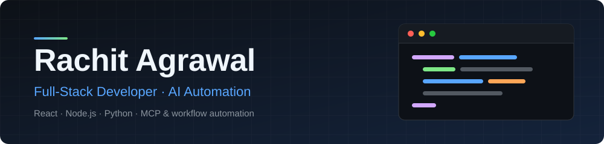

  <a href="mailto:rachit.agrawal.cs@gmail.com"><b>Email</b></a> &nbsp;·&nbsp;
  <a href="https://www.linkedin.com/in/rachit-agrawal-261062251"><b>LinkedIn</b></a> &nbsp;·&nbsp;
  <b>Open to Full-Stack, Software Developer &amp; AI Automation roles</b> &nbsp;·&nbsp; Remote or NCR

## About

I build web applications and AI-powered automation. B.Tech in CSE (Data Science specialization) from DCRUST, 2026, with hands-on experience shipping React front ends for production sites and building AI tooling with Python, the Anthropic SDK and MCP.

## Projects

| Project | What it is | Stack |
|---|---|---|
| **[CafeCanvas](https://github.com/CafeCanvas/CafeCanvas)** · [live](https://cafe-canvas.vercel.app) | Agency website with industry landing pages, case studies and a contact flow. Co-founded and built for small-business clients. | React 19, React Router, Vite, Tailwind CSS, Vercel |
| **[BMS IT Solutions](https://bmsitsolutionsindia.com)** | Production website for an ERP software company serving retail, distribution and manufacturing. I built the React front end. | React |
| **[Toothless](https://github.com/RachitAgrawal04/Toothless-personal_voice_assistant)** | Windows desktop voice assistant: speech recognition, spoken replies and an animated web UI. | Python, Eel, pyttsx3, HTML/CSS/JS |

## Experience

**Co-founder, CafeCanvas** — Web development, AI chatbots and workflow automation for small businesses.

**Web Developer, BMS IT Solutions** — Built and shipped the company's React website.

## Skills

| | |
|---|---|
| **Languages** |     |
| **Frontend** |    |
| **Backend &amp; Data** |      |
| **AI &amp; Automation** |      |
| **Tools** |    |

## Contact

**Email** · [rachit.agrawal.cs@gmail.com](mailto:rachit.agrawal.cs@gmail.com) &nbsp;&nbsp; **LinkedIn** · [rachit-agrawal-261062251](https://www.linkedin.com/in/rachit-agrawal-261062251)

Beyond code: I founded a 200-member Film &amp; TV club on campus, and I keep a small non-technical hobby blog at <a href="https://rachit-blogs.vercel.app/">rachit-blogs.vercel.app</a>.
